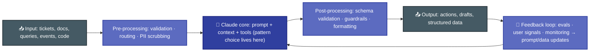
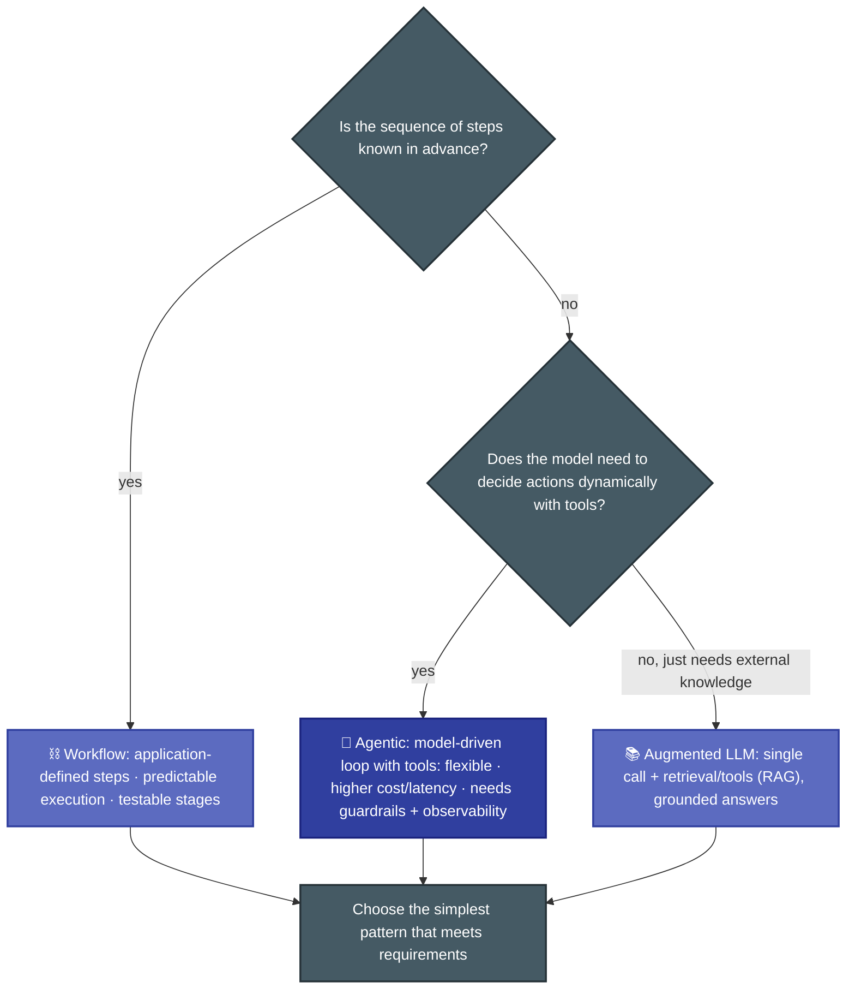
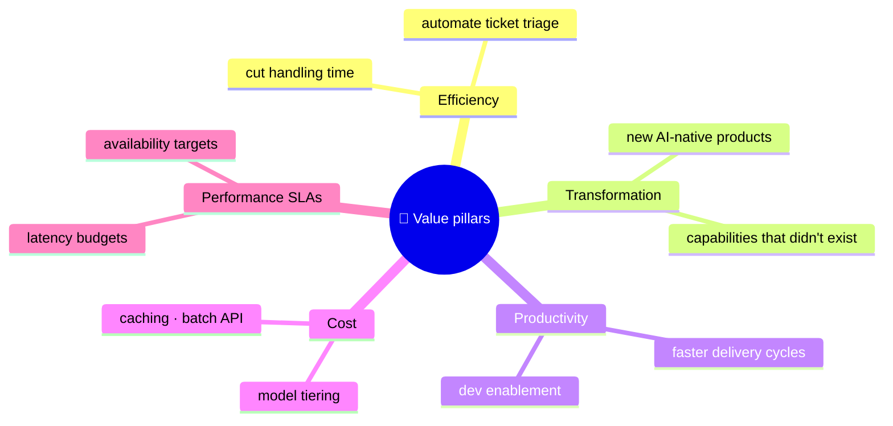

# P-D1 · Solution Design & Architecture (17%)

Choose an execution pattern, place validation and tools at the right boundaries, and measure the design against business requirements.

**Builds on CCA-F:** [F-D1 Agentic Architecture](../../CCA-F/domains/d1-agentic-architecture.md) (orchestration mechanics).
**Source:** official [CCA-P Exam Guide](../../official-exam-guides/cca-p-exam-guide.pdf), Domain 1 objectives; prep course "Claude Platform & Solution Design".

---

## End-to-end architecture shape

Place each concern in the appropriate pipeline stage:

## Pattern selection

The deciding factor is **who controls the next step**. A workflow follows application-defined steps; an agent chooses actions from intermediate results. Retrieval supplies knowledge to either pattern.

**Key points:**

- **Workflow:** A fixed sequence with an LLM at each step, such as classify → extract → draft. Use it when auditability and predictable cost matter.
- **Agentic:** The model plans and acts in a loop (see [F-D1 Sec. 1.1](../../CCA-F/domains/d1-agentic-architecture.md)). Use it only when decisions must adapt during the task.
- **Agent guardrails:** Set per-turn token budgets, maximum tool-call counts, and explicit stopping criteria. Expose only the tools needed.
- **Augmented LLM:** One model call supported by retrieved information or tool results. This is the common RAG pattern for Q&A and knowledge tasks.
- **Document processing:** Route low-confidence extractions to a human review queue.

## Multi-agent orchestration & decomposition

Apply the CCA-F principles at the solution-design level:

- Use a coordinator to delegate and synthesize. Isolate subagent contexts, pass required context explicitly, and parallelize independent work ([F-D1 Sec. 1.2–1.3](../../CCA-F/domains/d1-agentic-architecture.md)).
- **Use multiple agents when:** The task has separate specialities, one context cannot hold the work, or roles need different tool permissions.
- **Do not use them when:** One agent with a clear prompt and scoped tools is enough. Multiple agents add cost, delay, and more failure points.
- Split work by sub-problem, data partition, or pipeline stage. Use fixed chains for predictable flows and dynamic decomposition for open-ended work ([F-D1 Sec. 1.6](../../CCA-F/domains/d1-agentic-architecture.md)).

Assign an owner to each failure boundary so timeouts and empty results are retried or flagged, not silently lost.

| Failure | Where it lands | Design response |
|---|---|---|
| Malformed or empty subagent result | Subagent boundary (recoverable) | Validate each result; retry or reroute the failed unit, or record the gap |
| Conflicting subagent results | Synthesis step (recoverable) | Apply an explicit conflict-resolution rule or escalate to a human |
| Orchestrator loses the goal or synthesis state | Orchestrator (often unrecoverable) | Protect state and checkpoint progress so a failed run can resume |
| Traces fragment across agents | Observability (cross-cutting) | Propagate a shared trace ID to reconstruct the run end to end |

## Business value pillars

A design can improve accuracy while exceeding its cost or latency budget. Define the required outcome before comparing architectures:

**Decision rule:** Prefer the design that meets the stated goal within its constraints. Additional stages need a measured benefit.

---

## Extra practice (unofficial)

*No official sample questions exist for this domain; the CCA-P Exam Guide's 3 published samples cover Domains 2–4. Practice questions below are unofficial, written against this domain's official objectives.*

**P1.** A team wants a system that drafts a weekly executive summary from a fixed set of five internal reports. The steps are always the same: pull the five reports, extract key metrics, draft the summary, format as slides. Which pattern best fits?

- **A.** Agentic: let the model decide which reports to pull each week.
- **B.** Workflow: a fixed pipeline of LLM calls: extract → draft → format.
- **C.** Augmented LLM: one retrieval-augmented call over the five reports.
- **D.** Multi-agent: one subagent per report, coordinated by a hub agent.

Answer & rationale

**B.** The steps are always the same, so a workflow fits. Agentic (A) and multi-agent (D) add unnecessary cost and flexibility. One augmented call (C) would remove the clear, auditable stages.

**P2.** Stakeholders asked for a solution that minimizes infrastructure cost above all else. Your team proposes adding a verification pass with a larger model at every step, improving accuracy by 4% but roughly doubling per-request cost. Is this the right recommendation?

- **A.** Yes, higher accuracy is always the right trade-off.
- **B.** No, it optimizes a pillar (accuracy) the stakeholder didn't prioritize, at the direct expense of the one they did (cost).
- **C.** Yes, production systems should always maximize quality regardless of stated priorities.
- **D.** No, remove the verification pass and replace it with a single larger model instead.

Answer & rationale

**B.** Cost is the stated priority, not maximum accuracy. A and C ignore that goal. D also raises cost without addressing the mismatch.

**P3.** A support-ticket summarization task needs to read one ticket, pull the customer's order history, and write a one-paragraph summary. A vendor proposes a 4-agent system (router, ticket-reader, order-history-lookup, and writer) coordinated by a hub agent. What's the most defensible critique?

- **A.** It's correctly decomposed by specialization and should be kept as-is.
- **B.** It's over-engineered: a single agent with two scoped tools would meet requirements at lower latency, cost, and failure surface.
- **C.** It's under-engineered: it needs a fifth agent dedicated to quality review before the summary ships.
- **D.** It's correctly decomposed, but the four agents should run in parallel rather than hub-and-spoke.

Answer & rationale

**B.** The task has no separate speciality, parallel work, or context pressure. One agent with two scoped tools is enough. A accepts the unnecessary design, while C and D add more agent complexity.

**P4.** A code-review agent receives raw PR diffs, must strip out generated/vendored files before analysis, and its final output must pass a JSON-schema validator before posting to GitHub. Where do "strip out generated/vendored files" and "JSON-schema validation" belong in the architecture?

- **A.** Both inside the Claude core call itself, via prompt instructions.
- **B.** Pre-processing for the file-stripping step, post-processing for the schema validation.
- **C.** Both in a single post-processing stage, after Claude drafts its findings.
- **D.** Both in the feedback loop, applied only after production monitoring flags an issue.

Answer & rationale

**B.** Filter input before the model call and validate output afterward. A relies on model compliance for fixed checks. C sends unnecessary files to the model. D confuses pipeline stages with monitoring.

**P5.** A document-processing pipeline always performs the same four steps in the same order for every document: OCR → classify → extract → validate. A separate research task must explore an open-ended set of sub-questions whose number and order can't be known upfront. How should each be decomposed?

- **A.** Both should use dynamic decomposition, since decomposition always benefits from flexibility.
- **B.** The document pipeline should use a fixed chain (steps known in advance); the research task should use dynamic decomposition (open-ended, discovered at run time).
- **C.** Both should use a fixed chain, for predictability and lower cost.
- **D.** The document pipeline should use dynamic decomposition, since documents vary in content even if the steps don't.

Answer & rationale

**B.** Use fixed chains for known steps and dynamic decomposition for open-ended work. A adds unnecessary overhead. C cannot adapt to the research task. D confuses changing content with changing steps.

## Exam focus

| Cue in the question | Likely answer direction |
|---|---|
| "Steps are known and repeatable" | Workflow, not agent |
| "Must decide which systems to query based on the request" | Agentic |
| "Answers must be grounded in company docs" | Augmented LLM / RAG |
| "Simplest solution that meets requirements" | Downgrade the pattern |
| "Which design best supports [pillar]?" | Map features → that pillar only |

**Practice:** [claude-cookbooks `patterns`](https://github.com/anthropics/claude-cookbooks) (workflow vs agent notebooks) · [Tutorials Dojo CCAR-P guide](https://tutorialsdojo.com/ccar-p-claude-certified-architect-professional-study-guide/) (solution architecture section).
