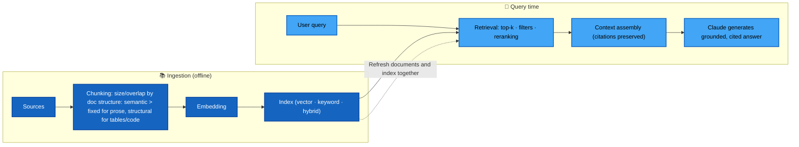
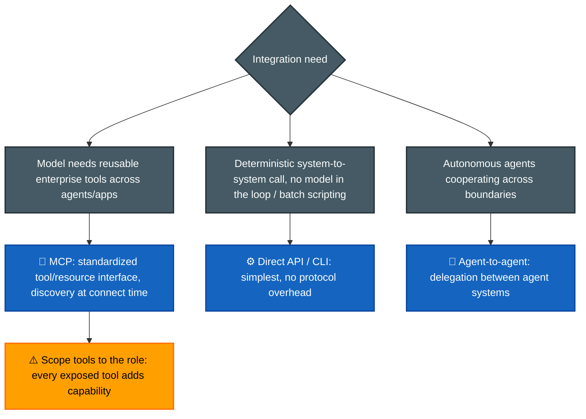
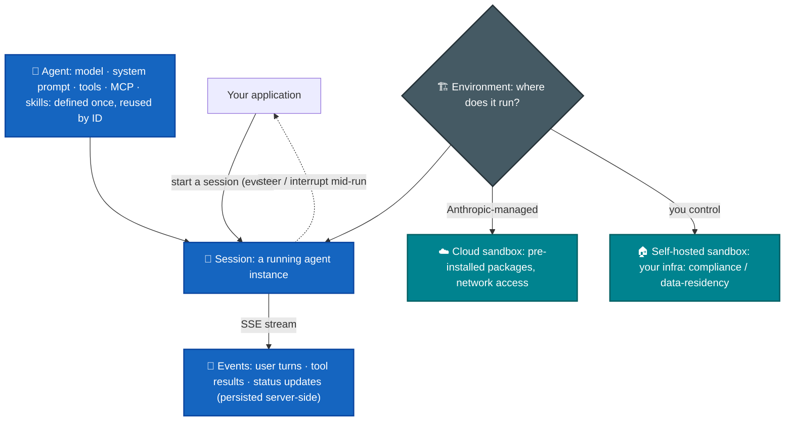
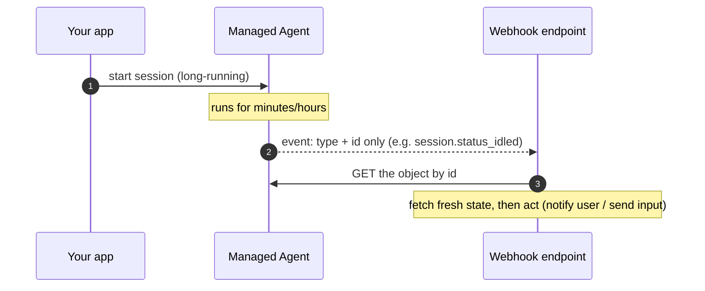
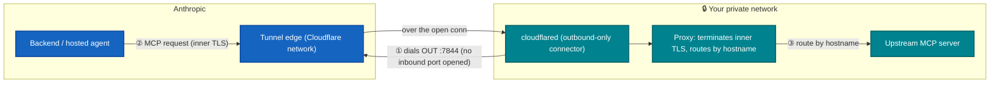

# P-D3 · Integration (19%)

The **largest CCA-P domain** covers retrieval, enterprise connections, hosted agents, security, and observability. RAG is the largest new topic beyond CCA-F.

**Builds on CCA-F:** [F-D2 Tool Design & MCP](../../CCA-F/domains/d2-tool-design-mcp.md).
**Source:** official [CCA-P Exam Guide](../../official-exam-guides/cca-p-exam-guide.pdf), Domain 3 objectives; prep course "Enterprise Integration & Production".

---

## RAG pipeline design

RAG separates **finding evidence** from **generating an answer**. Retrieval selects source material; generation uses that material. A stronger generation model cannot repair a stale index.

**Key points:**

- **Match chunking to the data:** Use overlapping semantic chunks for prose and structure-aware splits for tables, code, and structured documents. Small chunks lose context; large chunks weaken relevance.
- **Separate live-state queries from static knowledge queries:** Look up changing state directly rather than relying on a stale index.
- A document refresh without correct re-indexing, or an embedding mismatch, can cause **confident but wrong answers without changing latency**. Check retrieval first.
- **Retrieve only what each step needs** through MCP resources or targeted search. Do not place every document in one prompt. This improves cost, latency, and attention.

**Chunking approaches:**

| Approach | How it works | When to use it |
|---|---|---|
| Fixed-size | Split into uniform spans, optionally with overlap, regardless of structure | Homogeneous, unstructured text with weak natural boundaries; simple to operate |
| Semantic | Split on meaning boundaries, topic shifts, or related sentence groups | Prose where chunks need to stand alone; reduces mid-idea cuts |
| Hierarchical | Preserve sections and subsections; retrieve at the appropriate level | Structured documents such as contracts, manuals, and policies where section context matters |

**Indexing strategies:** Match retrieval to the query; add reranking when needed.

| Strategy | What it matches | When to use it |
|---|---|---|
| Dense (embeddings) | Semantic similarity | Paraphrases, intent, and concept matching |
| Sparse (keyword, e.g. BM25) | Exact terms, identifiers, codes, and names | Part numbers, statute citations, or error codes |
| Hybrid | Combines dense and sparse results | Mixed query patterns where exact matches and semantic similarity both matter |

> **Embedding details** ([platform: embeddings](https://platform.claude.com/docs/en/build-with-claude/embeddings)). Anthropic does not provide a first-party embedding model; its documentation points to third-party **Voyage AI**.
> - **Query and document embeddings use different settings:** Use `input_type="query"` for questions and `input_type="document"` for stored chunks. Omitting this reduces retrieval quality.
> - **Use domain-specific models** for specialised collections: `voyage-code-3`, `voyage-finance-2`, or `voyage-law-2`.
> - **Reranking is a separate stage:** Retrieve a broad top-k, then use `rerank-2.5` to select a short list before adding it to context.
> - **Embedding and generation use separate models.** Re-embedding with a model that differs from the existing index creates an embedding mismatch and poor results.

> **Citations provide attribution, not retrieval** ([platform: citations](https://platform.claude.com/docs/en/build-with-claude/citations)). Set `citations: {enabled: true}` on a `document` block. Claude returns claims with `cited_text` and a source location. Retrieval chooses which documents enter context; citations point back into those documents. Use both together. API citation text is not billed as output tokens or as later-turn input, making it cheaper and more reliable than asking the model to quote sources. For sentence-level citations, place each RAG chunk in a separate plain-text document. Use custom-content blocks when you need exact citation boundaries.

## Connection protocol selection

Choose the deployment route and interaction protocol separately. The route determines where inference runs and which features are available; the protocol determines how systems exchange tools or delegate work.

### Deployment entry-point selection

After compliance filtering, compare latency, cost, and the available route. Confirm feature availability and coverage for the specific configuration.

| Platform | Latency profile | Compliance posture | When to pick it |
|---|---|---|---|
| Direct Anthropic API | New features typically arrive first; few additional hops | Confirm coverage by configuration | Default when procurement or residency does not require another route |
| AWS Bedrock | Region-configurable; features may lag direct | AWS procurement and region rules require explicit configuration | AWS-standardized partner requiring in-region execution |
| GCP Vertex AI | Region-configurable; features may lag direct | GCP procurement and region rules require explicit configuration | GCP-standardized partner using Vertex procurement |
| Microsoft Foundry (Azure) | Depends on hosting: hosted-on-Azure runs in the partner's Azure environment; hosted-on-Anthropic routes to Anthropic infrastructure | Verify residency and coverage for the specific route | Procurement or residency requires that route |

For multi-entry-point designs, document which route owns each task and why. Check model identifiers, feature availability, and regional endpoints before integration.

## Managed Agents - the hosted-harness deployment choice

> Source: [platform: managed-agents/overview](https://platform.claude.com/docs/en/managed-agents/overview). Managed Agents lets Anthropic host the agent loop and a secure sandbox where Claude can read files, run commands, browse the web, and execute code. See [primer Section 2](../../claude-stack.md#2-what-a-harness-is---and-why-an-agent-needs-one) for the build-versus-adopt choice.

**State model:** Reuse an agent configuration across sessions. Each session retains task files and history in its environment; events record and stream the interaction.

**Use Managed Agents when you need:**

- **Long-running tasks:** Minutes-to-hours execution with many tool calls, beyond a single Messages API request/response.
- **Hosted execution:** The service supplies the agent loop, sandbox, and tool-execution layer.
- **Stateful sessions:** Files and conversation history persist across interactions and pauses.
- **Scheduled execution:** [Scheduled deployments](https://platform.claude.com/docs/en/managed-agents/scheduled-deployments) run on cron using Anthropic infrastructure, independently of the client machine. Compare Claude Code Routines in [F-D1](../../CCA-F/domains/d1-agentic-architecture.md).
- **Multi-agent execution:** Built-in [orchestration](https://platform.claude.com/docs/en/managed-agents/multiagent-orchestration) lets a coordinator spawn child threads ([F-D1 Sec. 1.2](../../CCA-F/domains/d1-agentic-architecture.md)).

**Governance limits:**

- **Use a self-hosted sandbox for data residency or compliance** when data cannot leave your infrastructure.
- **Hosted Managed Agents is stateful and is not currently ZDR or HIPAA-BAA eligible.** It stores history, sandbox state, and output on the server. For ZDR or HIPAA requirements, use the Messages API or a self-hosted environment.
- **Permission policies** gate session actions; **[vaults](https://platform.claude.com/docs/en/managed-agents/vaults)** supply credentials. Scope both to the task ([least privilege](#security-authnauthz--least-privilege)).

## Webhooks - the async notification pattern

> Source: [platform: managed-agents/webhooks](https://platform.claude.com/docs/en/managed-agents/webhooks). Webhooks tell an application when a long-running agent needs input or finishes. This avoids repeated polling.

**Key points:**

- **Events contain `type` and `id`, not the full object.** Fetch the resource by ID after receiving an event. This keeps events small and avoids using stale retry data.
- **Session events:** `session.status_run_started`, **`session.status_idled`** (awaiting input - e.g. a tool-permission approval or a new user message: the human-in-the-loop signal), `session.status_rescheduled` (transient error, auto-retrying), `session.status_terminated` (done or errored). Multi-agent threads add `session.thread_created/idled/terminated`.
- **Delivery is at least once and unordered.** Remove duplicates using `event.id` and do not infer state from arrival order. Delivery is attempted up to three times, so webhooks are not a complete event log. Fetch or list resources when every transition matters.
- **Security:** verify the `whsec_`-signed signature (SDK `unwrap()` throws on bad/stale >5-min payloads); endpoints must be **HTTPS on a public host**; a `3xx` or non-public IP **auto-disables** the endpoint.

## MCP tunnels - reaching an MCP server behind your firewall

> Source: [platform: mcp-tunnels/concepts](https://platform.claude.com/docs/en/agents-and-tools/mcp-tunnels/concepts) (research preview). MCP tunnels let an Anthropic-hosted agent reach an MCP server inside a private network without making that server public.

**Key points:**

- **"Outbound-only" describes the connection, not request direction.** `cloudflared` connects outward on port 7844, so no inbound firewall port is required. MCP requests then travel inward over that existing connection.
- **Inner TLS defines the payload boundary.** A second TLS handshake runs between Anthropic's backend and your proxy using a CA you registered. Cloudflare's edge sees ciphertext; your proxy terminates TLS and can read MCP payloads.
- **Keep the three MCP connection methods separate** (see [F-D2 Sec. 2.4](../../CCA-F/domains/d2-tool-design-mcp.md)):

| Mechanism | What it connects | Use when |
|---|---|---|
| **MCP connector** (`mcp_toolset`) | An Anthropic-hosted agent → a **publicly reachable** remote MCP server | The server is already exposed on the internet |
| **Remote MCP servers** | Standard client → a hosted MCP endpoint | General remote tool access |
| **MCP tunnel** | An Anthropic-hosted agent → an MCP server **in your private network** | The server **can't** be public (firewall / data boundary) |

- Credentials provision two ways: **programmatic** (setup component authenticates via [Workload Identity Federation](https://platform.claude.com/docs/en/manage-claude/workload-identity-federation), no hand-copied secret) or **manual** (copy tunnel token + register a CA yourself). WIF over long-lived secrets is the least-privilege-friendly choice.

## Files API - upload once, reference many

> Source: [platform: files](https://platform.claude.com/docs/en/build-with-claude/files) (beta). The Files API avoids uploading the same PDF or dataset with every request.

**Key points:**

- **Reference by ID:** Upload once, then use the returned `file_id` in Messages (`document`, `image`, or `container_upload` blocks). Reuse it for multi-turn document Q&A or datasets passed to [code execution](https://platform.claude.com/docs/en/agents-and-tools/tool-use/code-execution-tool).
- **Cost:** Upload, list, get, and delete operations are free. File content is billed as input tokens when used. The Files API saves bandwidth and upload work, not token cost. Combine it with **prompt caching** ([P-D2](d2-models-prompting-context.md)) for repeated stable documents.
- **Limits & lifecycle:** **500 MB/file**, **500 GB/org**; files are immutable (re-upload to change), scoped to the **workspace** (any key in it can reference them), and persist until you `DELETE` them. Uploaded files are **not downloadable** - only files **generated** by skills or code execution have `downloadable: true`.
- **Platform availability:** on the Claude API, Claude Platform on AWS, and Microsoft Foundry (Hosted-on-Anthropic) - **not** currently on Amazon Bedrock or Google Vertex. A scenario that mandates Bedrock/Vertex deployment can't assume the Files API.
- **Choose the content block by file type:** PDFs/plain-text → `document`; images → `image`; datasets for analysis → `container_upload` (code execution). For `.docx`/`.xlsx`, convert to text/PDF first.

## Security: authN/authZ & least privilege

Filter delivery routes by compliance obligations, including attorney-client privilege, before comparing cost or implementation effort. Review five integration layers; see [P-D5 compliance controls](d5-governance-safety-risk.md#compliance-regimes) for obligations and evidence.

| Layer | Architect's decision | What breaks when wrong |
|---|---|---|
| Compliance | Which routes and entry points meet HIPAA, GDPR, FedRAMP, data-residency, or BAA requirements | The chosen route fails legal or security review |
| Identity & SSO | Where the identity boundary sits; inject identity server-side | A user-asserted role in the prompt can be manipulated |
| Authorization | Which capabilities and data each user or role can access | Claude bypasses the existing access model |
| Data handling & PII | What must enter context versus what can be retrieved on demand | Sensitive fields land in plaintext application logs |
| Observability | What must be reconstructable after an incident | An unlogged path leaves no evidence when something breaks |

**Key points:**

- Review authentication **at each integration point:** identify the user or service, credential storage, and token scope. Use environment variables or secret managers, never committed configuration.
- **Least privilege:** Remove tools each role or subagent does not need. Logging, confirmation, and a larger model do not remove unnecessary capability (official sample 1; [F-D2 Sec. 2.3](../../CCA-F/domains/d2-tool-design-mcp.md)).
- Check for permission and isolation failures: agent runs with admin-scope service account; tokens shared across tenants; tool exposes destructive operations to a read-only workflow.
- **Data minimization:** Include only fields needed for the task. A clinical-intake summarizer needs presenting concerns, medications, and allergies, but may not need SSN or insurance ID; unnecessary fields can end up in plaintext logs.
- **Integration review example:** For a multi-tenant support agent, flag these risks: Claude Code used as a customer-facing backend, a shared API key across tenants, capability checks based on unverified user claims, and account numbers or emails in request logs. Server-side authentication and per-tenant storage isolation are sound components.

## Accuracy–latency trade-offs & observability

- Every extra stage, such as reranking, verification, or a larger model, trades cost and latency for accuracy. **Justify it against the stated SLA.**
- Levers: model tier per step · caching · parallel retrieval · streaming for perceived latency · batch for offline volume.
- Use the [P-D4 monitoring checklist](d4-evaluation-testing-optimization.md#monitoring--observability) for logs, traces, dashboards, and sampled review. Scrub PII from prompts and completions before logging.
- Make four things reconstructable: **request** (model, version, token count), **response** (tokens, latency, stop reason), **context** (user role, session, caching), and **outcome** (whether the downstream system accepted it). Observability can be a security-team prerequisite for approving agent actions.

---

## Official sample question

*From the [CCA-P Exam Guide](../../official-exam-guides/cca-p-exam-guide.pdf), Sec. 8, Sample 1.*

A team exposes a customer-support agent that can read tickets, draft replies, issue refunds, and delete user accounts. Support staff only ever need to read tickets and draft replies. Applying least-privilege principles, which change best reduces risk?

- **A.** Add logging to the refund and delete tools so misuse can be audited later.
- **B.** Remove the refund and delete tools from the agent's configuration entirely.
- **C.** Keep all tools but add a confirmation prompt before refunds and deletions.
- **D.** Replace the agent with a larger model that follows instructions more reliably.

Answer & rationale

**B.** Least privilege removes capabilities the role does not need. Logging or confirmation keeps the risk, while model size does not change authorization.

## Extra practice (unofficial)

**P1.** Users of an internal parts-lookup tool almost always search by exact SKU or error code (e.g. "ERR-4471"), rarely by natural-language description. Semantic vector search is returning plausible-sounding but wrong parts. What should the team do?

- **A.** Switch to keyword/exact-match retrieval (or hybrid weighted toward keyword) for this query pattern.
- **B.** Fine-tune the embedding model on the parts catalog.
- **C.** Increase top-k so more candidates reach the reranker.
- **D.** Add more few-shot examples showing correct SKU formatting to the generation prompt.

Answer & rationale

**A.** Exact identifiers need keyword or hybrid search. Better embeddings, more candidates, or prompt examples do not fix the wrong retrieval method.

**P2.** Three internal agent systems (research, drafting, and compliance-review, each built by a different team on a different stack) need to delegate sub-tasks to each other autonomously depending on what each one finds. What integration mechanism fits best?

- **A.** MCP: expose each team's capabilities as MCP tools.
- **B.** Direct API calls between the three teams' backends.
- **C.** Agent-to-agent delegation: each autonomous agent system hands off work to the others as needed.
- **D.** A shared CLI script that all three teams invoke in sequence.

Answer & rationale

**C.** Agent-to-agent delegation fits independent agents that cooperate based on findings. MCP exposes tools to a model, while direct APIs and scripts provide fixed system calls rather than adaptive delegation.

**P3.** An observability review finds that a document-summarization agent's MCP server exposes 40 tools, but 90 days of production traces show only 6 were ever called. What's the most effective next step?

- **A.** Add usage logging to the other 34 tools so future misuse can be audited.
- **B.** Remove the 34 unused tools from the agent's exposed configuration, keeping only the 6 in active use.
- **C.** Leave the configuration as-is, since unused tools carry no runtime cost.
- **D.** Consolidate all 40 tools into a single generic tool with a `mode` parameter.

Answer & rationale

**B.** Every exposed tool increases the risk surface, even when unused. Logging only observes the risk. Keeping or combining all tools does not reduce authorized capability.

**P4.** A RAG system ingests both narrative policy documents (prose) and large pricing tables, using the same semantic-chunking-with-overlap strategy for both. Retrieval quality is good for policy questions but poor for pricing questions; the model frequently gets partial or misaligned rows. What's the fix?

- **A.** Increase the overlap window uniformly across all document types.
- **B.** Use structure-aware chunking (e.g. row- or table-aware splits) for the pricing tables, while keeping semantic chunking for prose.
- **C.** Convert all documents to prose before chunking.
- **D.** Increase top-k for pricing-related queries only.

Answer & rationale

**B.** Chunking follows data shape: prose gets semantic chunks with overlap, tables/structured docs get structure-aware splits. Using one strategy for both is the root cause here.

**P5.** An architect proposes adding a verification pass (a second model call re-checking every answer) to a support agent with a stated 3-second p95 latency SLA. The pass adds 2.5 seconds on average. Leadership hasn't flagged any accuracy problems with the current system. What's the most defensible response?

- **A.** Add the verification pass, since accuracy improvements are always worth the cost.
- **B.** Ask what specific accuracy problem the pass is meant to solve, and whether the latency cost is justified against the stated SLA and business goal; don't add stages without a measured need.
- **C.** Add the verification pass, but only for 10% of requests, chosen at random.
- **D.** Reject the proposal outright without discussion, since any latency increase violates the SLA spirit.

Answer & rationale

**B.** Extra stages trade latency and cost for accuracy. No accuracy problem has been measured, and the new stage nearly uses the full latency budget. Require evidence before adding it.

**P6.** A healthcare workflow needs an agent that runs long, multi-step analyses over patient records. Requirements: the data must never leave the organization's infrastructure, and the deployment must be HIPAA-BAA-covered. An architect proposes Anthropic-hosted Claude Managed Agents "because it removes all the loop and sandbox plumbing." What's the problem?

- **A.** Nothing - Managed Agents is the best fit for long-running work, so adopt it as proposed.
- **B.** Hosted Managed Agents persists session state server-side and is **not** ZDR- or HIPAA-BAA-eligible; use a self-hosted sandbox (or the Messages API on your own infra) to keep data in-boundary and meet the compliance constraint.
- **C.** Managed Agents can't run multi-step tasks, so it's the wrong tool regardless.
- **D.** Switch to a larger model tier so the agent is more accurate on medical data.

Answer & rationale

**B.** Hosted Managed Agents stores history, sandbox state, and output on the server. It is not currently covered by ZDR or a HIPAA BAA, so it does not meet the stated requirements.

**P7.** A retrieval MCP server holding proprietary data runs inside a company's private VPC and cannot be exposed to the public internet. The team wants an Anthropic-hosted agent to query it. A security reviewer insists this requires opening an inbound firewall port so Anthropic can reach in. Using MCP tunnels, what's the accurate picture?

- **A.** Correct - an inbound port must be opened for Anthropic's backend to connect to the private MCP server.
- **B.** No inbound port is needed: the tunnel connector dials **outbound** to the tunnel edge, and MCP requests then flow inward over that already-open connection; inner TLS terminates at your proxy so the transport never sees payloads.
- **C.** The MCP server must be moved to a public host; tunnels only work with internet-reachable servers.
- **D.** Use the MCP connector (`mcp_toolset`) instead - it reaches private servers directly.

Answer & rationale

**B.** `cloudflared` connects outward on port 7844, so no inbound port is needed. Requests return through the same connection. A reverses the connection setup, C removes the private-network benefit, and D works only with public servers.

**P8.** An app starts long-running Managed Agent sessions and subscribes to webhooks. On `session.status_idled` it currently reads the agent's status straight from the webhook body and shows it to the user; occasionally it displays stale or out-of-order state. What's the correct pattern?

- **A.** Poll the session status every few seconds instead of using webhooks.
- **B.** Treat the webhook as a signal only - it carries `type` + `id`; **fetch the session object by ID** to get fresh state, dedupe on `event.id`, and drive UI from the fetched resource rather than event arrival order.
- **C.** Trust the webhook body but add a 30-second delay before displaying it.
- **D.** Unsubscribe from `status_idled` and rely solely on the SSE stream.

Answer & rationale

**B.** Webhooks provide `type` and `id`, so fetch the current resource state. Delivery may repeat or arrive out of order, so deduplicate by `event.id`. Polling wastes resources, delays do not fix stale data, and SSE alone loses the external notification.

## Exam focus

| Cue | Direction |
|---|---|
| "Wrong answers after document refresh" | Retrieval/indexing first, not the model |
| "Users search by exact SKU / error code" | Keyword or hybrid retrieval |
| "Agent has tools the workflow never uses" | Remove them (capability bloat / least privilege) |
| "Reusable enterprise tool layer for several agents" | MCP |
| "Giant prompt with every doc pasted in" | Progressive discovery / retrieval |
| "Can't tell why production answers degraded" | Tracing + retrieval-hit logging + eval sampling |
| "Long-running / async agent, minimal infra" | Managed Agents (hosted harness + sandbox) |
| "Data can't leave our infra" + long agent runs | Self-hosted sandbox (not hosted Managed Agents); check ZDR/HIPAA |
| "Private MCP server, no public exposure" | MCP tunnel (outbound-only), not MCP connector |
| "How does my app know the async agent is done / needs input?" | Webhooks (fetch by id), not polling |
| "Stop re-sending the same PDF/dataset every call" | Files API (`file_id`) + prompt caching |
| "Answers must cite verifiable sources" | Citations feature (`citations.enabled`) |
| "Which embedding model?" | No first-party model → Voyage; domain-specific + `input_type` |

**Practice:** [claude-cookbooks RAG recipes + `observability`](https://github.com/anthropics/claude-cookbooks) · [MCP docs](https://modelcontextprotocol.io) · [Tutorials Dojo CCAR-P guide](https://tutorialsdojo.com/ccar-p-claude-certified-architect-professional-study-guide/) (RAG + integration sections).
